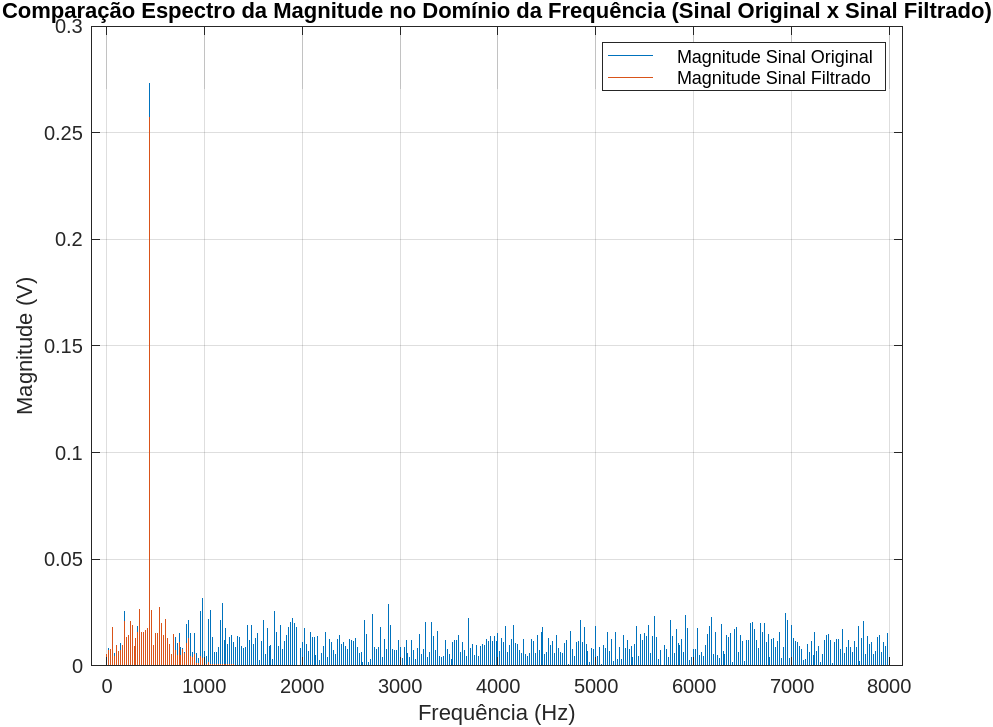

# Processamento de sinais em MATLAB

Atividades da disciplina de Processamento de Sinais (Engenharia de Computação, UFMT): composição
de sinais, modelagem de sistemas no Simulink, conversão analógico-digital e projeto de filtros
digitais, incluindo a **filtragem de um áudio ruidoso com um filtro FIR**.



## Atividades

| Pasta | O que faz |
|---|---|
| `trabalho1-composicao-de-sinais/` | soma de senoides de 50, 200 e 4000 Hz e análise do sinal composto no tempo e na frequência |
| `matlab/aula1-circuito-rlc/` | função de transferência de um circuito RLC (corrente e tensão no capacitor como saída) e simulação no Simulink |
| `matlab/aula3-sinais-basicos/` | lista de exercícios de sinais e sistemas no MATLAB (impulso e resposta de sistemas) |
| `matlab/aula4-conversao-ad/` | amostragem e conversão analógico-digital no Simulink |
| `matlab/atividade-3-filtro-digital/` | filtro passa-baixas projetado no Filter Designer e aplicado a um sinal |
| `matlab/atividade-5-filtro-fir-audio/` | filtro FIR passa-baixas por janelamento (Hamming, ordem 99, corte em 850 Hz, 16 kHz) aplicado a um áudio com ruído: sinal no tempo, FFT antes e depois e diagrama de Bode do filtro |

## Como rodar

Abra a pasta da atividade no MATLAB e rode o script. Os scripts carregam os dados (`.mat`, `.wav`)
da própria pasta. O filtro FIR usa a Signal Processing Toolbox; os modelos `.slx` abrem no Simulink.

```matlab
cd matlab/atividade-5-filtro-fir-audio
filtro_fir_audio
```
